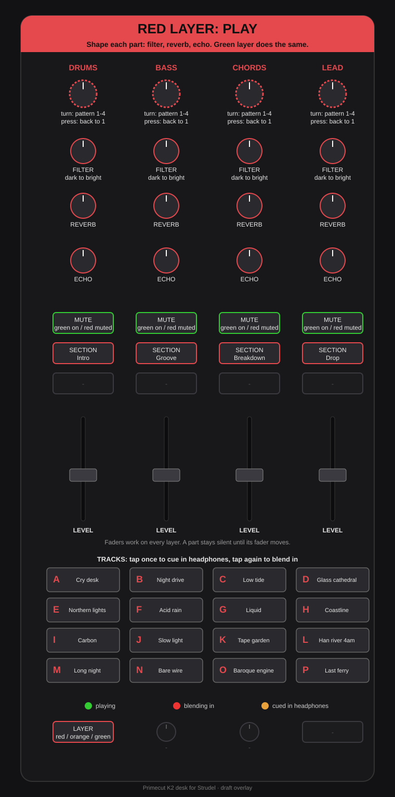
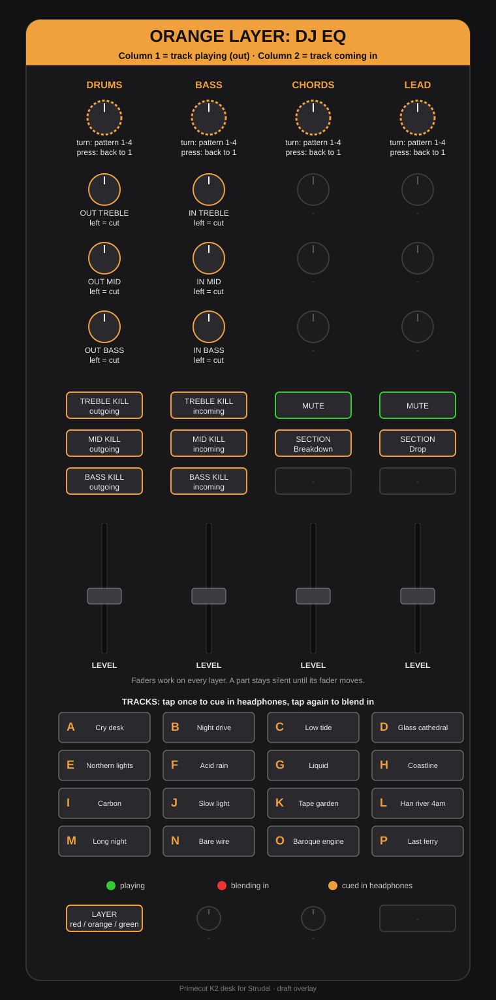

# Primecut Xone:K2 Strudel Desk

Play [Strudel](https://strudel.cc) live from an Allen & Heath Xone:K2, like a DJ desk. It needs nothing but a browser.

- **16 tracks** on the bottom grid (A–P). They share one key and tempo: 122 bpm, E minor (Camelot 9A).
- **Tap a letter once** to cue it in your headphones. **Tap it again** and it blends in over 8 bars, starting on the next 4-bar phrase. The bass swaps over cleanly halfway through.
- **One K2 column per part:** drums, bass, chords and lead. Each has a fader, a mute, a section (Intro, Groove, Breakdown or Drop), and filter, reverb and echo.
- **DJ EQ** is on the orange layer: treble, mid and bass for the outgoing and incoming tracks, with kill switches.
- The K2's lights show what's going on.

As far as we could find, this is the first K2 mapping for Strudel.

## Quick start

1. Plug in the K2 and open [strudel.cc](https://strudel.cc) in Chrome or Chromium. Allow MIDI when it asks.
2. Paste in `k2-desk.js` and press **Ctrl+Enter**.
3. **Push the faders up.** A part stays silent until its fader moves.

The K2 must be on MIDI channel 14, which is its factory default.

## The overlay

| Red layer: play | Orange layer: DJ EQ |
|---|---|
|  |  |

The green layer currently does the same as the red layer. To redraw the overlay, run `bun overlay/overlay.ts overlay`.

## Headphone cueing (Linux, PipeWire)

The K2's built-in sound card has two stereo pairs:

- **Front pair:** the headphone jack.
- **Rear pair:** the main outputs.

On Linux, browsers only give Strudel 2 output channels. The desk works around that by sending everything as mono:

- **Left channel:** the master mix.
- **Right channel:** the cue.

A small PipeWire loopback then routes the left channel to the speakers and the right channel to the headphones:

```sh
pw-loopback -n k2-split \
  --capture-props='media.class=Audio/Sink node.name=k2_split node.description="K2 Split" audio.position=[FL FR]' \
  --playback-props='node.name=k2_split_out audio.position=[FL FR] node.autoconnect=false node.dont-reconnect=true' &

K2=alsa_output.usb-ALLEN_HEATH_LTD._XONE_K2-00.analog-surround-40
pw-link k2_split_out:output_FL $K2:playback_RL
pw-link k2_split_out:output_FL $K2:playback_RR
pw-link k2_split_out:output_FR $K2:playback_FL
pw-link k2_split_out:output_FR $K2:playback_FR
```

Then make "K2 Split" your default output, reload strudel.cc and paste the desk. The loopback lasts until you reboot.

On macOS, Chrome may give Strudel all four of the K2's channels directly. That hasn't been tested yet.

## Status

The desk has been played live on a real K2. Headphone cueing passes automated tests, but nobody has tested it by ear yet.

Ideas for the spare controls:

- Master gain and cue volume on the two bottom knobs.
- Per-part FX on the third row of buttons.
- Per-instrument levels on the green layer.

## Licence

MIT. See `LICENSE`.
